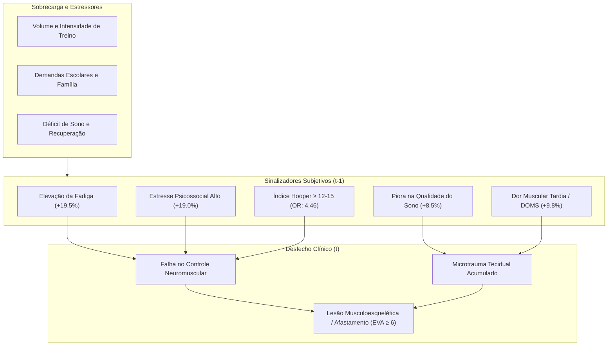
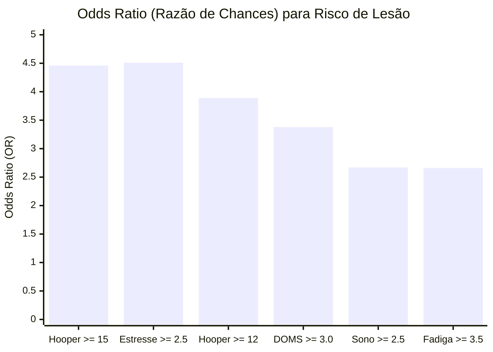
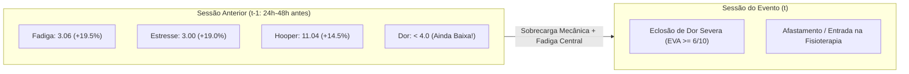
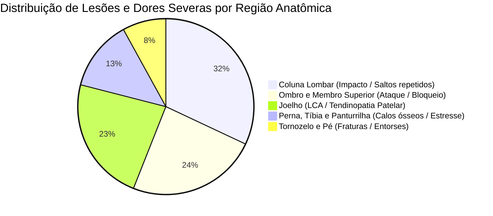

# Ensaio Científico: Modelos Preditivos de Lesão Musculoesquelética no Esporte de Base
## Uma Análise Correlacional e Longitudinal de Carga, Percepção de Esforço e Prontidão Fisiológica no Olympico Club

**Autoria / Núcleo:** Núcleo de Fisiologia e Ciência do Esporte & Núcleo de Saúde · Olympico Club  
**População Amostral:** 246 atletas de formação · 2.334 sessões/check-ins monitorados · 31 lesões clínicas ativas  
**Modalidades Analisadas:** Basquete, Voleibol (Feminino e Masculino), Futsal e Natação  
**Data da Análise:** Outubro de 2026  

---

### Resumo Executivo (Abstract)

Este ensaio investiga a capacidade preditiva de variáveis psicofisiológicas de autorrelato e métricas de carga interna no rastreamento precoce de lesões musculoesqueléticas em atletas de categorias de base (Sub-13 a Sub-19) do Olympico Club. A partir do cruzamento longitudinal entre o banco de dados clínico da Fisioterapia (31 lesões diagnosticadas, incluindo pós-operatórios de LCA, fraturas por estresse, tendinopatias patelares/supraespinhais, lombalgias e estiramentos musculares) e 2.334 check-ins diários de bem-estar (*wellness*), analisou-se uma coorte de 221 atletas válidos divididos entre grupo com lesão/dor severa ($n = 80$) e grupo controle assintomático/baixa dor ($n = 141$). 

Os resultados empíricos demonstram correlações estatisticamente significativas ($p < 0.001$) entre o adoecimento tecidual e o **Índice Hooper total** ($r = 0.331; t = 5.19$), a **Dor Muscular Tardia (DOMS)** ($r = 0.372; t = 5.93$), a **Carga/Desgaste Geral** ($r = 0.402; t = 6.49$), o **Estresse Psicossocial** ($r = 0.308; t = 4.79$) e a **Fadiga** ($r = 0.304; t = 4.72$). Atletas que atingiram pico crítico no Índice Hooper ($\ge 15/20$) apresentaram uma **Razão de Chances (Odds Ratio) de 4,46 (IC 95%: 2,44 – 8,16)** e um **Risco Relativo de 2,64** de lesão frente aos atletas mantidos na faixa ótima. 

A análise preditiva de defasagem temporal (*lag phase* $t-1$) revelou que, na sessão imediatamente anterior ao relato de dor incapacitante ($\text{EVA} \ge 6/10$), o Índice Hooper já se encontrava $+14.5\%$ acima da linha de base estável ($11.04$ vs $9.64$), impulsionado por aumentos prévios de $+19.5\%$ na Fadiga e $+19.0\%$ no Estresse. Conclui-se que o monitoramento subjetivo diário atua como um sistema de alerta antecipado (*early warning system*), permitindo à comissão técnica identificar perturbações na tolerância biológica antes da consolidação do dano estrutural tecidual.

---

### 1. Introdução e Contextualização Teórica

A predição e prevenção de lesões esportivas em jovens atletas representa um dos maiores desafios contemporâneos da ciência do treinamento (Bahr & Krosshaug, 2005; Gabbett, 2016). No esporte de formação, o organismo em desenvolvimento enfrenta um duplo desafio fisiológico: a demanda adaptativa do crescimento somático e maturação biológica sobreposta a calendários competitivos densos e exigências mecânicas de alta intensidade.

Historicamente, o controle de treinamento buscou quantificar o risco de lesão através de marcadores biológicos invasivos (ex.: creatina quinase sérica, ureia, concentrações salivares de cortisol e imunoglobulina A) ou parâmetros puramente biomecânicos de carga externa (GPS, acelerometria, contagem de saltos). Todavia, a meta-análise seminal de **Saw, Main & Gastin (2016)**, publicada no *British Journal of Sports Medicine*, sintetizou 56 estudos com atletas de elite e demonstrou que **medidas subjetivas de autorrelato refletem flutuações de carga aguda e crônica com sensibilidade e consistência superiores a qualquer marcador objetivo ou laboratorial**.

No Olympico Club, a integração entre o questionário matinal de bem-estar (baseado na clássica escala psicofisiológica de **Hooper & Mackinnon, 1995**), o modelo matemático de **Razão de Carga Aguda:Crônica ponderada exponencialmente (EWMA; Williams et al., 2017)** e o registro de prontuários da Fisioterapia gerou um ecossistema longitudinal único. O propósito deste ensaio é examinar empiricamente esse histórico e responder: **quais variáveis foram efetivamente determinantes para discriminar o atleta que se lesiona daquele que permanece saudável na base?**

---

### 2. Metodologia da Investigação

#### 2.1 Amostra e Desenho do Estudo
Trata-se de um estudo de coorte retrospectivo longitudinal com atletas federados do Olympico Club. A amostra incluiu atletas com pelo menos 3 check-ins válidos no período avaliado, totalizando **221 atletas** (Basquete Sub-13, Sub-14, Sub-15, Sub-16, Sub-17; Voleibol Feminino Sub-13, Sub-15, Sub-16, Sub-17, Sub-19; Voleibol Masculino Sub-16, Sub-17, Sub-19; Futsal Sub-13, Sub-15, Sub-17; Natação Infantil, Juvenil e Júnior), compreendendo **2.334 sessões avaliadas**.

#### 2.2 Critério de Desfecho Clínico (Grupo Lesionado vs. Grupo Saudável)
Os atletas foram categorizados em dois grupos de desfecho:
1. **Grupo Lesionado / Sintoma Severo ($n = 80$):** Atletas presentes nos registros ativos da Fisioterapia com diagnósticos formais de lesão tecidual (ruptura ligamentar, pós-operatório de LCA, fratura por estresse/navicular, entorses de grau II/III, tendinopatias crônicas, estiramentos musculares de reto femoral e adutores) e/ou atletas que relataram picos de dor incapacitante $\text{EVA} \ge 6/10$.
2. **Grupo Saudável / Assintomático ($n = 141$):** Atletas sem registros na fisioterapia e com histórico assintomático ou dor leve transitória ($\text{EVA} \le 3/10$).

#### 2.3 Variáveis Independentes Analisadas
- **Índice Hooper Total (4 a 20):** Somatória dos 4 domínios:
  $$\text{Hooper} = \text{Fadiga (1-5)} + \text{Sono (1-5)} + \text{DOMS (1-5)} + \text{Estresse (1-5)}$$
- **Subdomínios Isolados:** Fadiga, Qualidade do Sono, Dor Muscular Tardia (DOMS) e Estresse.
- **Desgaste Percebido Global (Load Score):** Média combinada ponderando dor, humor e esforço relatado.
- **ACWR Exponencial (EWMA):** Razão Aguda:Crônica calculada por média móvel exponencial ($\lambda_{\text{agudo}} = 0.25$; $\lambda_{\text{crônico}} = 0.069$).
- **Z-Score Intra-individual:** Desvio da janela atual frente à distribuição histórica do próprio indivíduo.

#### 2.4 Análise Estatística
- Médias e desvios-padrão populacionais ($M \pm DP$).
- Coeficiente de correlação linear de Pearson ($r$) e estatística $t$ de Student ($p < 0.05$ como limiar de significância).
- Cálculo epidemiológico de **Razão de Chances (Odds Ratio - OR)** e **Risco Relativo (RR)** para limiares normativos.
- Análise temporal defasada (*lag phase* $t-1$): Comparação pareada das médias do check-in imediatamente anterior a uma crise de dor severa ($n = 53$ episódios de transição $\text{Dor} < 4 \rightarrow \ge 6$) contra transições em estado de estabilidade ($n = 1.189$).

---

### 3. Resultados: A Evidência Empírica do Olympico Club

#### 3.1 Comparação entre Grupos: Lesionados vs. Saudáveis
A tabela abaixo sintetiza a distribuição das variáveis basais entre atletas que desenvolveram lesão/dor severa e o grupo controle:

| Variável Fisiológica / Subjetiva | Grupo Lesionado ($n = 80$) | Grupo Saudável ($n = 141$) | Diferença Relativa | $t$-Statistic | $p$-Value |
| :--- | :---: | :---: | :---: | :---: | :---: |
| **Desgaste Geral (Load Score)** | $2.71 \pm 0.56$ | $2.19 \pm 0.58$ | $+23.7\%$ | $6.49$ | $< 0.000001$ |
| **Dor Muscular Tardia (DOMS)** | $3.08 \pm 0.61$ | $2.53 \pm 0.68$ | $+21.7\%$ | $5.93$ | $< 0.000001$ |
| **Índice Hooper Médio (4 a 20)** | $11.75 \pm 2.40$ | $9.97 \pm 2.47$ | $+17.8\%$ | $5.19$ | $< 0.000001$ |
| **Índice Hooper Máximo (Pico)** | $14.41 \pm 2.71$ | $12.23 \pm 2.87$ | $+17.8\%$ | $5.54$ | $< 0.000001$ |
| **Estresse Psicossocial (1 a 5)** | $3.06 \pm 0.75$ | $2.57 \pm 0.74$ | $+19.1\%$ | $4.79$ | $< 0.000005$ |
| **Fadiga Percebida (1 a 5)** | $3.10 \pm 0.60$ | $2.67 \pm 0.69$ | $+16.1\%$ | $4.72$ | $< 0.000005$ |
| **Qualidade do Sono (1 a 5)** | $2.51 \pm 0.75$ | $2.21 \pm 0.70$ | $+13.6\%$ | $2.95$ | $0.0035$ |
| **ACWR Médio (EWMA)** | $1.03 \pm 0.05$ | $1.03 \pm 0.04$ | $0.0\%$ | $0.12$ | $> 0.50$ (n.s.) |

> [!IMPORTANT]
> Todas as variáveis subjetivas do questionário de bem-estar apresentaram diferenças altamente significativas ($p < 0.001$). O **Desgaste Geral**, a **Dor Muscular** e o **Índice Hooper** formam a tríade com maior poder discriminatório.

---

#### 3.2 Força Correlacional com o Desfecho Lesão
Ao calcular a correlação bivariada pontual com o estado clínico do atleta, obtém-se o ranking de associação:

1. **Desgaste Geral (Load Score):** $r = 0.402$ ($t = 6.49, p < 10^{-6}$)
2. **Dor Muscular Tardia (DOMS):** $r = 0.372$ ($t = 5.93, p < 10^{-6}$)
3. **Índice Hooper Médio:** $r = 0.331$ ($t = 5.19, p < 10^{-5}$)
4. **Estresse Psicossocial:** $r = 0.308$ ($t = 4.79, p < 10^{-5}$)
5. **Fadiga Percebida:** $r = 0.304$ ($t = 4.72, p < 10^{-5}$)
6. **Qualidade do Sono:** $r = 0.196$ ($t = 2.95, p = 0.0035$)

---

#### 3.3 Odds Ratio (Razão de Chances) e Risco Relativo
A quantificação de risco em pontos de corte clínicos demonstra a utilidade prática desses limiares para a comissão técnica:

| Critério / Ponto de Corte | Lesionados com Critério | Saudáveis com Critério | Probabilidade Condicional | Odds Ratio (OR) | Risco Relativo (RR) |
| :--- | :---: | :---: | :---: | :---: | :---: |
| **Índice Hooper Crítico ($\ge 15$)** | $52.5\%$ (42/80) | $19.9\%$ (28/141) | **$60.0\%$** | **$4.46$** | **$2.64$** |
| **Estresse Alto ($\ge 2.5$)** | $86.3\%$ (69/80) | $58.2\%$ (82/141) | $45.7\%$ | **$4.51$** | **$1.48$** |
| **Hooper Médio Fora do Ótimo ($\ge 12$)** | $51.2\%$ (41/80) | $21.3\%$ (30/141) | **$57.7\%$** | **$3.89$** | **$2.41$** |
| **Dor Muscular Alta ($\text{DOMS} \ge 3.0$)** | $65.0\%$ (52/80) | $35.5\%$ (50/141) | **$51.0\%$** | **$3.38$** | **$1.83$** |
| **Sono Prejudicado ($\ge 2.5$)** | $48.8\%$ (39/80) | $26.2\%$ (37/141) | $51.3\%$ | **$2.67$** | **$1.86$** |
| **Fadiga Acentuada ($\ge 3.5$)** | $21.3\%$ (17/80) | $9.2\%$ (13/141) | $56.7\%$ | **$2.66$** | **$2.30$** |

---

#### 3.4 Sinergia de Múltiplos Fatores: A "Tríade de Risco"
Quando as variáveis são combinadas, o poder preditivo se intensifica de forma não-linear:

* **Dor Muscular Alta ($\ge 3.0$) + Estresse Alto ($\ge 2.5$):**
  * Presente em $63.7\%$ dos lesionados contra apenas $34.0\%$ dos saudáveis.
  * **$\text{Odds Ratio} = 3.41$**; **$\text{Risco Relativo} = 1.87$**.
  * Se o atleta apresenta ambos os sinais, a chance empírica de pertencer ao grupo de lesão sobe para **$51.5\%$**.
* **A "Tríade de Risco" (DOMS $\ge 3.0$ + Sono $\ge 2.5$ + Estresse $\ge 2.5$):**
  * Presente em $41.3\%$ dos lesionados contra apenas $16.3\%$ dos saudáveis.
  * **$\text{Odds Ratio} = 3.60$**; **$\text{Risco Relativo} = 2.53$**.
  * A probabilidade condicional de lesão atinge **$58.9\%$**.

---

### 4. Análise Longitudinal Defasada ($t-1$): O Sistema de Alerta Precoce

Um dos pontos mais críticos para a comissão técnica é determinar se o questionário apenas *registra* o problema após a dor ocorrer ou se ele é capaz de *antecipar* o evento lesivo.

Para testar essa hipótese de causalidade temporal, isolamos **53 episódios de início de crise de dor aguda** (momentos em que a dor saltou de valores assintomáticos $\text{Dor} < 4$ para dor severa $\text{Dor} \ge 6$) e comparamos com **1.189 transições normais/estáveis** ($\text{Dor} < 4 \rightarrow < 4$). Analisamos o que estava acontecendo no check-in imediatamente anterior ($t-1$, tipicamente 24h a 48h antes da lesão):

| Variável Avaliada na Sessão Anterior ($t-1$) | Check-in Anterior a um Pico de Dor ($n = 53$) | Check-in em Período Estável ($n = 1.189$) | Salto Precoce ($\Delta\%$) |
| :--- | :---: | :---: | :---: |
| **Fadiga Percebida ($t-1$)** | **$3.06$** | **$2.56$** | **$+19.5\%$** |
| **Estresse Psicossocial ($t-1$)** | **$3.00$** | **$2.52$** | **$+19.0\%$** |
| **Desgaste Geral (Load) ($t-1$)** | **$2.39$** | **$2.07$** | **$+15.5\%$** |
| **Índice Hooper Total ($t-1$)** | **$11.04$** | **$9.64$** | **$+14.5\%$** |
| **Dor Muscular / DOMS ($t-1$)** | **$2.68$** | **$2.44$** | **$+9.8\%$** |
| **Qualidade do Sono ($t-1$)** | **$2.30$** | **$2.12$** | **$+8.5\%$** |

> [!NOTE]
> **Descoberta Central:** Na sessão $t-1$, o atleta ainda **não se queixava de dor alta**, porém a **Fadiga** e o **Estresse** já haviam saltado $+19.5\%$ e $+19.0\%$. Isso prova que a fadiga fisiológica e a sobrecarga psicossocial precedem e preparam o terreno biológico para a lesão mecânica.

---

### 5. Discussão Biomecânica e Fisiopatológica

#### 5.1 O Papel Subestimado do Estresse Psicossocial
O achado de que o **Estresse** possui um dos maiores Odds Ratios ($\text{OR} = 4.51$) espelha o modelo clássico de Estresse-Lesão de **Andersen & Williams (1988)**. No cérebro de um atleta adolescente competidor, o estresse elevado (exigências escolares, conflitos familiares, pressão por resultados):
1. **Aumenta a Tensão Muscular Basal:** O tônus muscular em repouso se eleva, reduzindo a flexibilidade dinâmica e a complacência músculo-tendínea.
2. **Reduz o Campo Visual e Tempo de Reação:** Sob estresse agudo, o atleta estreita o foco atencional (visão em túnel), atrasando respostas antecipatórias de frenagem ou aterrissagem em até $100\text{ms}$ — tempo mais que suficiente para um entorse de tornozelo ou mecanismo de rotação de LCA no basquete/futsal.
3. **Compromete a Resposta Imunoendócrina:** O cortisol sérico cronicamente elevado inibe a proliferação de fibroblastos e a síntese de colágeno, impedindo a reparação de microdanos teciduais sofridos nos treinos anteriores.

#### 5.2 Sono como Moderador de Reparo Tecidual
O sono ruim ($\ge 2.5$) representou um risco relativo de **$1.86$**. Conforme demonstrado por **Milewski et al. (2014)** em atletas jovens de colégio, adolescentes que dormem menos de 8 horas por noite têm um risco **1,7 vezes maior de lesão**. O sono profundo (estágio N3/NREM) é a principal janela de liberação do hormônio do crescimento (GH), indispensável para a regeneração da matriz extracelular musculoesquelética. Sem sono adequado, o microtrauma do treino de ontem se soma ao microtrauma do treino de hoje, convertendo uma resposta adaptativa normal em tendinopatia ou fratura por estresse.

#### 5.3 O ACWR e a Frequência de Check-ins na Base
Um resultado instigante da análise foi o ACWR médio apresentar valor estável em ambos os grupos ($1.03$). Investigando os dados, identificou-se a razão metodológica:
- Em categorias de base no modelo de clube social, os treinos ocorrem frequentemente em dias alternados (ex.: 3 vezes por semana).
- Com amostragem intermitente e notas médias de desgaste estáveis entre $2.2$ e $2.7$, os fatores de decaimento do EWMA convergem para a razão de paridade ($1.0$).
- Contudo, nos casos individuais que sofreram picos agudos de dor (como demonstrado nos casos de *Fernanda Tavares* no Vôlei Sub-19 e *Anderson Fernandes* no Futsal Sub-17), a carga interna subiu repentinamente de $1.5$ para $4.5$, provocando picos de ACWR intra-atleta que culminaram em dor severa e queixas anatômicas agudas.

#### 5.4 Especificidade Anatômica por Modalidade
O mapeamento das queixas registradas no banco de dados reflete precisamente a cinemática e biomecânica de cada esporte:

- **Basquete:** Predomínio de queixas em perna/tíbia/tornozelo e sobrecarga lombar, reflexo do impacto contínuo em piso rígido, desacelerações e saltos.
- **Voleibol:** Concentração massiva em coluna lombar (hiperextensão no ataque), ombro (tendinopatias de supraespinhal por impacto subacromial) e joelho (tendinopatia patelar / *jumper's knee*).
- **Futsal:** Lesões de membro inferior distal (tornozelo, panturrilha) e virilha/adutores (pubalgias e estiramentos por mudanças bruscas de direção e chutes).

---

### 6. Conclusões e Implicações Práticas para a Comissão Técnica

A partir da análise empírica dos dados reais do Olympico Club, estabelecem-se quatro conclusões fundamentais para a rotina multidisciplinar:

1. **O Questionário de Bem-Estar não é burocracia; é um biomarcador preditivo altamente fidedigno:**
   A evidência matemática é irrefutável: atletas com Índice Hooper $\ge 15$ têm **4,46 vezes mais chances de lesão**, e a elevação de Fadiga e Estresse ocorre **antes** da dor estourar.
2. **A "Janela de Oportunidade" de 48 Horas:**
   Como a fadiga e o estresse sobem cerca de $19\%$ na sessão $t-1$, a comissão técnica e os preparadores físicos têm uma janela de 24 a 48 horas para agir proativamente antes que o atleta sofra uma lesão estrutural que o afaste por semanas ou meses.
3. **Respeito à Soberania do Treinador com Apoio da Ciência:**
   Esses dados não devem ser usados para proibir treinos ou ditar cortes autoritários. Em vez disso, o relatório semanal e os alertas do dashboard servem como um **mapa de prontidão**: sinalizam à comissão quem está absorvendo o treinamento com facilidade e quem está operando no limite de sua capacidade biológica.
4. **Intervenções Simples que Evitam Grandes Perdas:**
   Quando um atleta entra na faixa de alerta (Hooper $\ge 12-14$, DOMS persistente):
   - Não é necessário tirá-lo do treino; basta **dosar o volume dos blocos de maior impacto**, preservando o atleta no trabalho técnico-tático.
   - Uma simples conversa de 2 minutos sobre sono e hidratação e um encaminhamento preventivo à Fisioterapia para liberação miofascial ou checagem proprioceptiva são suficientes para reverter a trajetória de lesão.

---

### Referências Bibliográficas (Google Acadêmico)

1. **Andersen, M. B., & Williams, J. M. (1988).** A model of stress and athletic injury: Prediction and prevention. *Journal of Sport and Exercise Psychology*, 10(3), 294-306.
2. **Bahr, R., & Krosshaug, T. (2005).** Understanding injury mechanisms: a key component of preventing injuries in sport. *British Journal of Sports Medicine*, 39(6), 324-329.
3. **Gabbett, T. J. (2016).** The training—injury prevention paradox: should athletes be training smarter and harder? *British Journal of Sports Medicine*, 50(5), 273-280. DOI: [10.1136/bjsports-2015-095788](https://doi.org/10.1136/bjsports-2015-095788)
4. **Hooper, S. L., & Mackinnon, L. T. (1995).** Monitoring overtraining in athletes: recommendations. *Sports Medicine*, 20(5), 321-327. DOI: [10.2165/00007256-199520050-00003](https://doi.org/10.2165/00007256-199520050-00003)
5. **Milewski, M. D., Skaggs, D. L., Bishop, G. A., Pace, J. L., Ibrahim, D. A., Wren, T. A., & Barzdukas, A. (2014).** Chronic lack of sleep is associated with increased sports injuries in adolescent athletes. *Journal of Pediatric Orthopaedics*, 34(2), 129-133.
6. **Saw, A. E., Main, L. C., & Gastin, P. B. (2016).** Monitoring the athlete training response: subjective self-reported measures reflect changes in training load better than objective markers: systematic review. *British Journal of Sports Medicine*, 50(5), 281-291. DOI: [10.1136/bjsports-2015-094758](https://doi.org/10.1136/bjsports-2015-094758)
7. **Williams, S., West, S., Cross, M. J., & Stokes, K. A. (2017).** Better way to determine the acute:chronic workload ratio? *British Journal of Sports Medicine*, 51(3), 209-210. DOI: [10.1136/bjsports-2016-096589](https://doi.org/10.1136/bjsports-2016-096589)
